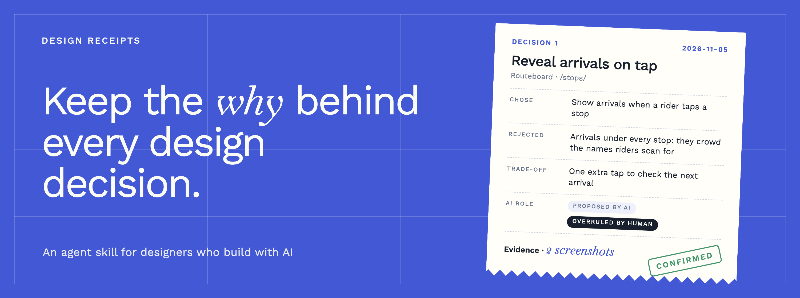
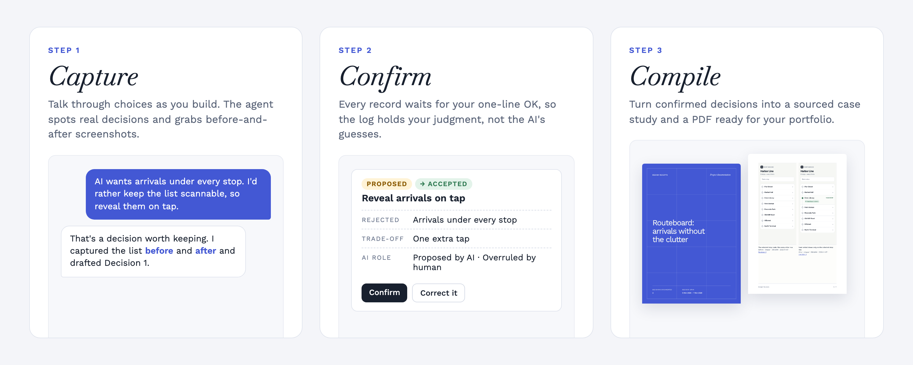
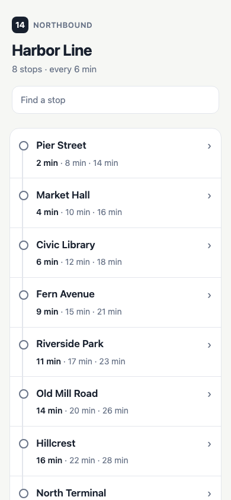
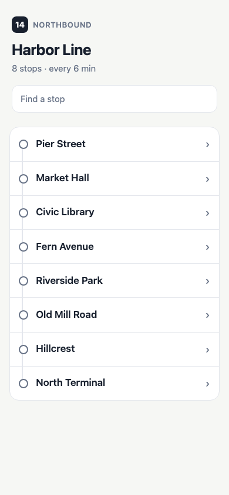
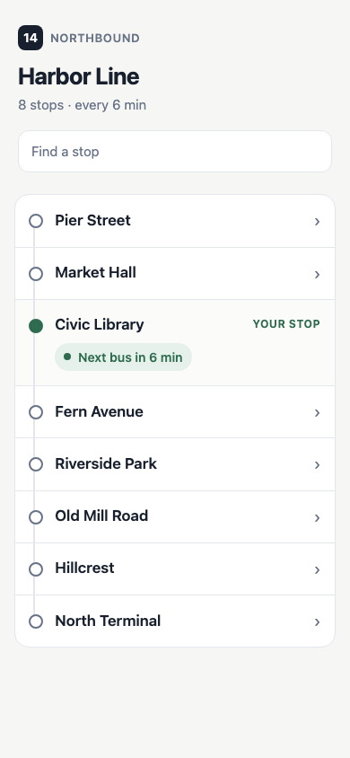
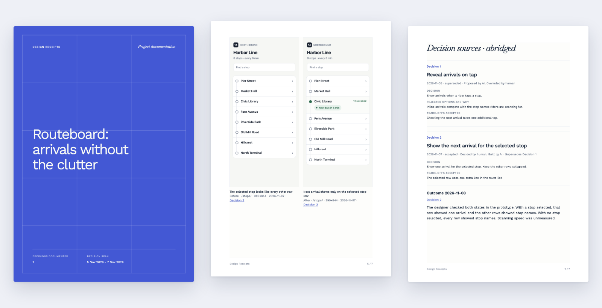

<a href="https://github.com/anavekaraditya/design-receipts">
  
</a>

<br/>

<div align="center">
  <strong>An agent skill for designers who build with AI.</strong><br/>
  It captures the reasoning behind each design change, saves screenshots from the running app,<br/>and turns your confirmed decisions into a sourced portfolio case study.
  <br/><br/>

[](https://github.com/anavekaraditya/design-receipts/actions/workflows/check.yml)


[](LICENSE)
<br/>


</div>

# Design Receipts

AI makes it fast to build. It also makes it easy to forget **why** the product looks the way it does: which option you picked, what you threw away, what it cost, and when you overruled the AI. By portfolio time, the reasoning is gone and only the final screens remain.

Design Receipts keeps that reasoning while you work. Say one line at the start of a build session:

> **Keep a decision trail as we build.**

Your agent then logs the decisions that matter, with screenshots as evidence, and waits for your OK before anything counts.

## How it works



| What you get | Where it lives | What it holds |
| --- | --- | --- |
| **Decision record** | `docs/decisions/1-*.md` | The choice, rejected options and why, trade-offs, and AI's role |
| **Screenshots** | `docs/decisions/events/` | Before and after captures of the same screen, taken from your running app |
| **Case-study draft** | `docs/decisions/drafts/*.md` | A sourced, editable story that links every claim to its decision |
| **PDF export** | `docs/decisions/drafts/*.pdf` | A designed document with paired screenshots, ready to share |

Everything stays in plain Markdown inside your project. No account, no service, no database.

## Quick start

You need a Git project, Python 3.10 or newer, and Claude Code, Codex, or Cursor.

### Install once for all your projects (recommended)

```sh
git clone https://github.com/anavekaraditya/design-receipts.git "$HOME/design-receipts-src"
cd "$HOME/design-receipts-src"
```

<details open>
<summary><b>Claude Code</b></summary>

```sh
mkdir -p "$HOME/.claude/skills"
cp -R skills/design-receipts "$HOME/.claude/skills/"
```

</details>

<details>
<summary><b>Codex or Cursor</b></summary>

```sh
mkdir -p "$HOME/.agents/skills"
cp -R skills/design-receipts "$HOME/.agents/skills/"
```

</details>

Start a new chat in any Git project and invoke `/design-receipts` in Claude Code and Cursor, or `$design-receipts` in Codex. Each project keeps its own decision log. [Claude Code skill locations](https://code.claude.com/docs/en/skills#choose-where-skills-load) · [Codex skill locations](https://learn.chatgpt.com/docs/build-skills#where-codex-loads-local-skills) · [Cursor skill locations](https://cursor.com/docs/skills#skill-directories)

<details>
<summary><b>Install in a single project instead</b></summary>

From the root of the project you're building, clone the skill beside it:

```sh
git clone https://github.com/anavekaraditya/design-receipts.git ../design-receipts-src
```

**Claude Code**

```sh
mkdir -p .claude/skills
cp -R ../design-receipts-src/skills/design-receipts .claude/skills/
```

**Codex or Cursor**

```sh
mkdir -p .agents/skills
cp -R ../design-receipts-src/skills/design-receipts .agents/skills/
```

Open a new agent chat in that project and invoke the skill.

</details>

## Your first session

1. **Start before editing.** Use the prompt above while the old UI is still available. For a visible change in a runnable web app, the agent can start or reuse the local dev server and capture the same screen or interaction before and after the edit. If the earlier state is already gone, the agent can still attach the after screenshot. [Browser setup and capture guide](skills/design-receipts/references/screenshots.md)
2. **Build as usual.** Talk through choices in the chat. When a meaningful decision comes up, the agent saves a proposed decision record with the choice, rejected alternatives, trade-offs, AI's role, and any screenshots it captured. Confirm or correct the proposal in one reply. To capture just one decision, say **"Log this decision"** and describe what you chose and why.
3. **Ask for a draft when you need one.** Say **"Make a concise case study from the most important confirmed decisions."** The agent picks the decisions and screenshots that tell the story and gives you an editable Markdown draft. It links back to the original records and marks unmeasured results `[verify]`. Ask for a **full archive** when you want every record and screenshot.

## See it in action

In **Routeboard**, a fictional transit app, the AI suggested showing live arrivals under every stop. The designer chose to reveal them on tap so stop names stay easy to scan, accepting one extra tap. Later they changed course and showed the next arrival on the selected stop only.

<table>
<tr>
<td align="center" width="33%"><br/><sub><b>AI's proposal</b><br/>Arrivals under every stop</sub></td>
<td align="center" width="33%"><br/><sub><b>Decision 1</b><br/>Stop names only; arrivals on tap</sub></td>
<td align="center" width="33%"><br/><sub><b>Decision 2</b><br/>Next arrival on the selected stop</sub></td>
</tr>
</table>

The [decision record](examples/routeboard/decisions/1-reveal-arrivals-on-tap.md) keeps that reasoning with the project, and the draft uses it to tell the story:

> The route list needed to stay easy to scan. I chose to put arrival predictions behind a tap to give stop names more room, accepting one additional step to check the next arrival. [Decision 1](examples/routeboard/decisions/1-reveal-arrivals-on-tap.md)

[Read the complete case-study draft](examples/routeboard/case-study.md) · [Replay the example](examples/routeboard/README.md) · [Open the prototype](examples/routeboard/prototype/stops/index.html)

## Export a PDF for your portfolio



Ask **"Export my case-study draft as a PDF."** The agent exports your edited Markdown draft with its selected screenshots, captions, and decision citations. The default PDF includes compact source notes for the cited decisions. Ask for the **archive edition** to include every referenced record field. `[verify]` gaps stay visible for you to fill.

The PDF has a blue cover, readable type, generous spacing, and captioned screenshots, with matching before and after states side by side. Its fonts are bundled so exports look the same in every project.

PDF export uses a local Node.js, Playwright, and Chromium setup. It saves a new file in `docs/decisions/drafts/` by default, and you can ask for a different filename or destination. [PDF export guide](skills/design-receipts/references/export.md)

## Things to ask your agent

Open `docs/decisions/README.md` for an index of decisions and their screenshots. If your project already uses `docs/decisions/`, give the agent a different project-relative folder.

| When you want to | Ask the agent |
| --- | --- |
| Log a single choice | "Log this decision. I chose … because …" |
| See what needs your attention | "Show me the decisions waiting for confirmation." |
| Preserve a change of direction | "We changed course. Record what replaced Decision 1 and why." |
| Add something you learned later | "Add this usability test finding to Decision 1." |
| Draft a focused case study | "Tell the onboarding story with the best before-and-after screenshots." |
| Keep the complete trail | "Compile the full decision archive." |
| Get a document to share | "Export my case-study draft as a PDF with the screenshots." |

Claude Code and Codex can also show an optional reminder when a turn changes project files, in one project or across all your projects with a decision log. [Reminder setup](skills/design-receipts/references/hooks.md)

## Privacy, updates, and removal

- **Private by default.** New logs, screenshots, and default drafts are Git-ignored. Use `init --track` to put a new log under version control. Review the text and images before sharing, and keep secrets and personal data out of the record. Your agent handles conversation and decision text according to its own data settings.
- **Update.** Run `git pull --ff-only` in your checkout of this repository and replace the installed skill folder with the refreshed copy. Start a new agent chat to load it.
- **Uninstall.** Remove any [reminders you installed](skills/design-receipts/references/hooks.md) and delete the installed `design-receipts` skill folder. Your decision log and images stay in your project.

## Preview status

The capture, confirmation, and compile workflow was tested end to end in Codex, Cursor, and Claude Code. Browser screenshots and PDF export were verified with a live Chromium run. Claude Code also ran the prompt hook.

Run the local checks with `python3 -SB -m unittest discover -s tests -v`.

<br/>

<div align="center">
<table>
<tr>
<td align="center" width="100%">

<h4>Designing with AI? Keep your receipts.</h4>

<sub>If Design Receipts helps you tell the story behind your work, a star helps other designers find it.</sub>

<a href="https://github.com/anavekaraditya/design-receipts"></a>
<a href="https://github.com/anavekaraditya/design-receipts/issues"></a>

<sub>[Changelog](CHANGELOG.md) · [MIT License](LICENSE)</sub>

</td>
</tr>
</table>
</div>
